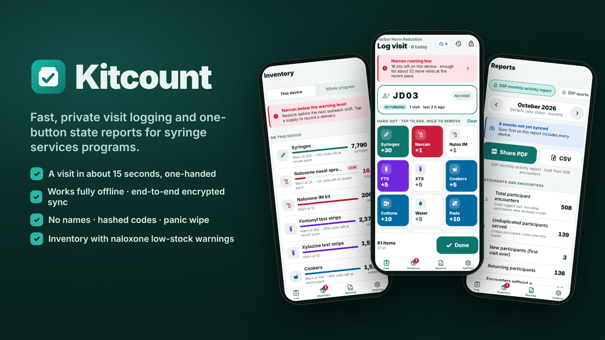
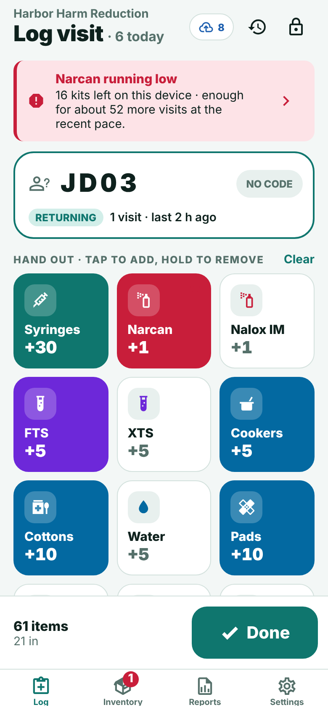
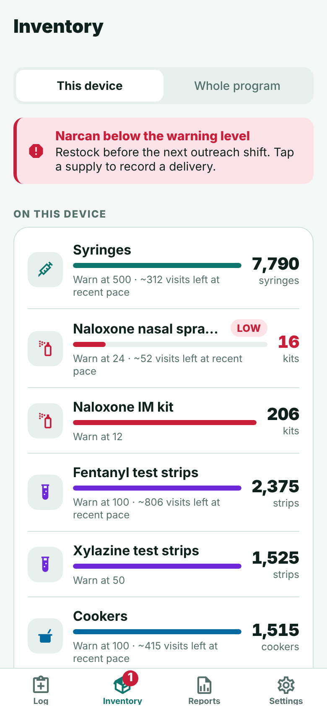
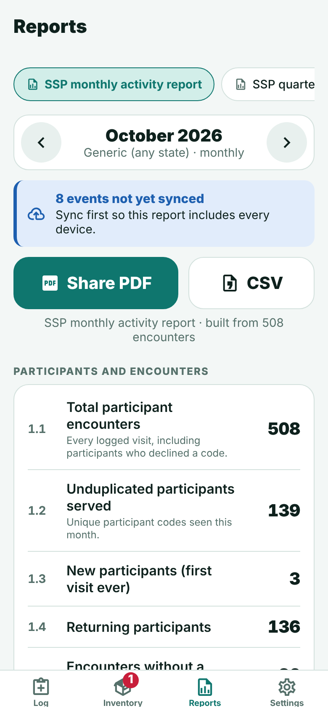
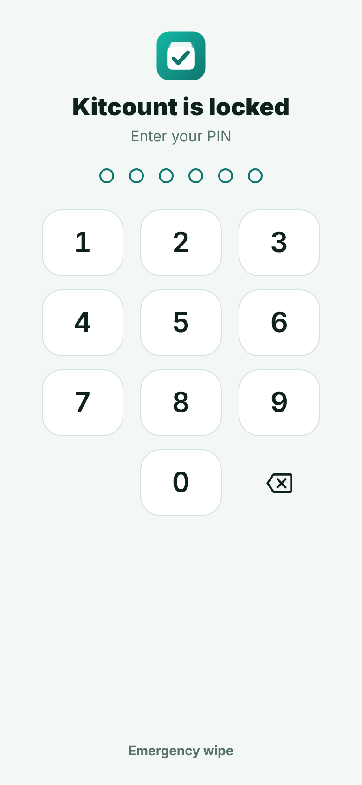
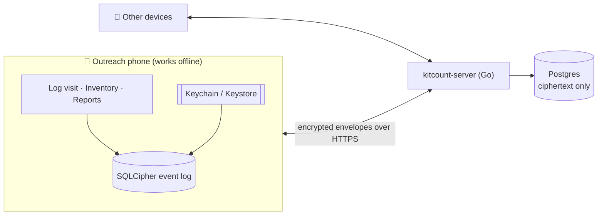

<p align="center">
  
</p>

<p align="center">
  <a href="https://github.com/lobojoel2003/Kitcount/actions/workflows/ci.yml"></a>
  <a href="https://github.com/lobojoel2003/Kitcount/actions/workflows/codeql.yml"></a>
  <a href="https://github.com/lobojoel2003/Kitcount/releases/latest"></a>
  <a href="LICENSE"></a>
  <a href="server/LICENSE"></a>
  
</p>

**Kitcount** is a free, open-source data app for **syringe services programs
(SSPs)**. Outreach staff log a visit in about 15 seconds, one-handed: enter
the participant's code, tap the supplies handed out, done. It works fully
offline in vans and on the street, never stores names, and turns a month of
visits into your state's report with one button.

<table>
  <tr>
    <td align="center"><br><b>Log a visit</b><br><sub>Code, tap tiles, done</sub></td>
    <td align="center"><br><b>Inventory</b><br><sub>Counts down, warns early</sub></td>
    <td align="center"><br><b>State report</b><br><sub>One tap to PDF or CSV</sub></td>
    <td align="center"><br><b>Locked by default</b><br><sub>PIN, duress PIN, panic wipe</sub></td>
  </tr>
</table>

## Why

SSPs hand out sterile supplies, naloxone and test strips, and connect people
to care. To keep their funding they report counts to their state health
department: participant visits, syringes out and in, naloxone kits, overdose
reversals and referrals. Participants are often anonymous, so programs use
self-made codes such as initials plus birth month. Outreach happens with poor
signal, and the data is highly sensitive.

- [KFF counts 522 SSPs](https://www.kff.org/hiv-aids/state-indicator/syringe-services-programs/)
  in 43 states, DC and Puerto Rico (2025 data).
- The University of Washington's SSP technical assistance center lists
  [REDCap and Excel](https://www.sharpta.uw.edu/data-storage) as the main
  tools, and notes that *"there is no one software solution that will work for
  all SSPs"*.
- States publish their own reporting templates, for example
  [Kentucky's](https://www.chfs.ky.gov/agencies/dph/Documents/datarg2025HarmReduction.pdf).

REDCap is free only through a research institution, and it is a general survey
tool, not a street-outreach app. Spreadsheets have no offline sync or privacy
controls. Earlier open-source attempts
([HarmReductionTracker](https://github.com/HarmReductionTrackerGroup/HarmReductionTracker),
[deliver-harm-reduction](https://github.com/leahdevs/deliver-harm-reduction))
were abandoned. Kitcount is built for this one job.

## Features

**Fast, one-handed logging**
- Big supply tiles: tap adds a preset amount (syringes in 10s), press and hold to take it back. Haptics confirm each tap.
- Instant feedback on the code: *new participant*, or *returning · 12 visits · last seen 3 days ago*.
- Syringes collected, overdose reversals, secondary distribution and referrals in one screen. Undo from the toast or the history.
- "No code" for participants who decline. They count as encounters but not as unduplicated participants.

**Private by design**
- No names and no free-text fields anywhere. Participant codes are stored only as a keyed HMAC ([why that matters](docs/privacy-and-security.md#participant-codes)).
- **SQLCipher**-encrypted database whose key never leaves the iOS Keychain / Android Keystore. Android backups are off; on iOS a backed-up copy is unreadable without the device-bound key.
- 6-digit PIN, auto-lock, screenshot and app-switcher blocking, wipe after 10 wrong PINs.
- **Panic wipe** (hold 3 s), a **duress PIN** that silently wipes, and **remote wipe** for lost devices.

**Offline first, end-to-end encrypted sync**
- Everything works without signal. Visits queue on the phone.
- Self-hosted Go + Postgres server that only ever sees **XChaCha20-Poly1305** ciphertext.
- Add devices with a QR code and a fingerprint check. Revoke or wipe them from the server.

**Inventory that keeps up**
- Stock counts down as kits go out, per device (van, backpack) and program-wide.
- **Naloxone first** warnings on the log screen, with a forecast like *"16 kits left · about 52 more visits at the recent pace"*.
- Record deliveries, physical counts and removals (expired, damaged, transferred).

**One-button state reports**
- Reports are defined by [YAML templates](docs/report-templates.md): line codes, exact wording, metrics, filters, formulas and manually entered rows.
- Pick the month or quarter, review, and share a print-ready **PDF** or a **CSV**.
- Import your state's template in the app. No new release needed.

## How it works



All data is an append-only log of small events: visits, voids, stock changes
and settings. Devices sync those events through the server and converge
without conflicts. See [architecture](docs/architecture.md) and the
[sync protocol](docs/sync-protocol.md).

## Quick start

### Try the demo (no install)

Download `kitcount-web-demo-<version>.zip` from the
[latest release](https://github.com/lobojoel2003/Kitcount/releases/latest),
unzip it and serve the folder with any static server, or run it from source:

```bash
cd app && npm ci && npm run web
```

Choose **Explore the demo with sample data**. It loads three months of
synthetic visits. The demo PIN is `246810`. The browser build keeps everything
in memory and is for evaluation only. Real programs use the mobile apps.

### Install the app

- **Android**: download `kitcount-<version>-build<n>.apk` from the
  [latest release](https://github.com/lobojoel2003/Kitcount/releases/latest)
  and install it on your phones or tablets.
- **iOS**: build from source with Xcode (`cd app && npx expo run:ios --configuration Release`) or EAS.

Open Kitcount → **Set up a new program** → name it → choose a PIN. You can log
visits immediately; sync is optional.

### Run the sync server

```bash
git clone https://github.com/lobojoel2003/Kitcount.git
cd Kitcount/deploy
cp .env.example .env               # set POSTGRES_PASSWORD and KITCOUNT_DOMAIN
docker compose --profile https up -d
docker compose exec server kitcount-server device add -name "Van 1"
```

Paste the printed token into the app under **Settings → Sync**. The full guide
is in [docs/deployment.md](docs/deployment.md). Prebuilt server binaries and
the `ghcr.io/lobojoel2003/kitcount-server` image are published with every
release.

## Report templates

```yaml
kitcount_template: 1
id: my-state-monthly
name: My State — SSP Monthly Report
jurisdiction: My State Department of Health
period: month
sections:
  - title: Syringe exchange
    rows:
      - { id: b1, code: B1, label: Syringes dispensed, metric: supplies_out, supply: syringes }
      - { id: b2, code: B2, label: Syringes returned, metric: syringes_in }
      - { id: b3, code: B3, label: Return rate, formula: b2 / b1, format: percent }
```

Three templates are bundled: a generic monthly report, a quarterly summary
with inventory, and a fully commented example to copy for your state. The
bundled templates are starting points; **check every line against your
state's current guidance before submitting**. Templates for specific states
are very welcome: see the [template guide](docs/report-templates.md) and the
*State report template* issue form.

## Security at a glance

| If… | Kitcount… |
| --- | --- |
| a phone is lost or seized | keeps data in an AES-256 SQLCipher database whose key never leaves the secure keystore; can be wiped remotely |
| someone demands it be unlocked | accepts a duress PIN that silently erases everything |
| the server is breached | exposes only ciphertext; participant codes are keyed hashes the server cannot reverse |
| someone guesses PINs | wipes after 10 attempts |

Read the full [privacy and threat model](docs/privacy-and-security.md),
including what Kitcount does **not** protect against. Report vulnerabilities
privately as described in [SECURITY.md](SECURITY.md).

## Development

| | |
| --- | --- |
| App | `cd app && npm ci` · `npm run web` (demo) · `npm run android` (needs Android SDK) · `npm test` · `npm run lint` · `npm run typecheck` |
| Server | `cd server && go test ./...` · `KITCOUNT_DATABASE_URL=memory go run ./cmd/kitcount-server` |
| End-to-end | start a server, then `KITCOUNT_E2E_URL=… KITCOUNT_E2E_ADMIN_TOKEN=… npm run test:e2e` |
| Screenshots | `npm run export:web && npm run screenshots` |

Stack: React Native 0.88 with Expo SDK 58 and Expo Router · expo-sqlite with
SQLCipher · `@noble/ciphers` and `@noble/hashes` (audited, pure JS) · Go 1.26
with pgx and Postgres 17.

## Versioning, CI/CD and releases

- One version for everything in [`VERSION`](VERSION) ([SemVer](https://semver.org)); the build number is the commit count, so it always goes up.
- Every push and pull request runs lint, type checks, unit tests, Postgres-backed server tests, a cross-language end-to-end sync test, a browser smoke test, a Docker build and CodeQL. Pushes to `main` also build an Android APK.
- `scripts/release.sh 1.1.0 && git push --follow-tags` publishes a GitHub release with the APK, AAB, server binaries for five platforms, a multi-arch Docker image, the web demo, checksums and build provenance attestations.

Details: [docs/releasing.md](docs/releasing.md) · history: [CHANGELOG.md](CHANGELOG.md).

## Roadmap

- iOS build in CI and store listings (App Store, Google Play, F-Droid)
- Optional anonymous demographics on first visit (age band, gender) for states that require them
- More state templates, contributed with programs in each state
- Multiple sites per program, with per-site reports
- Signed template packs that sync from an administrator device

## Contributing

Contributions are welcome, especially from people who run or work at SSPs.
See [CONTRIBUTING.md](CONTRIBUTING.md) and the
[Code of Conduct](CODE_OF_CONDUCT.md).

## License

- The **app** (`app/`) and report templates are licensed under the
  [GNU GPL v3.0 or later](LICENSE).
- The **sync server** (`server/`) is licensed under the
  [GNU AGPL v3.0](server/LICENSE). If you run a modified server for others,
  you must offer them its source. `/healthz` links to it.

Kitcount is not affiliated with or endorsed by any state agency or the
organisations cited above. It is a tool; each program remains responsible for
its own data practices and the accuracy of its reports.
