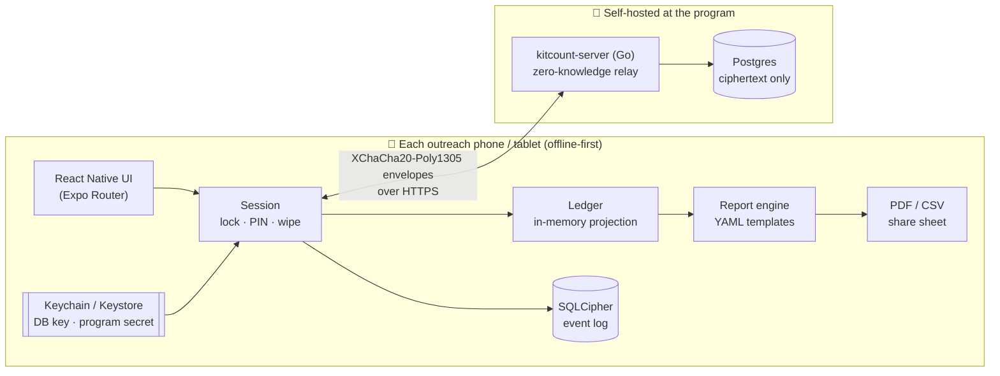

# Architecture



## Repository layout

```
app/                 React Native (Expo SDK 58) app — GPL-3.0-or-later
  src/core/          Pure TypeScript domain: crypto, events, ledger, reports, sync (unit tested)
  src/platform/      SQLCipher store, keystore, files (native) + in-memory web demo variants
  src/state/         Session (lock/unlock/wipe/sync) and React provider
  src/screens/       Screens; src/app/ holds the Expo Router routes
  src/ui/            Theme and components (tiles, PIN pad, hold-to-confirm, …)
  plugins/           Expo config plugin for Android release signing
  scripts/           Template bundler, icon renderer, screenshots/smoke test
server/              Go sync server — AGPL-3.0
  cmd/kitcount-server  CLI: serve, migrate, device add/list/revoke/wipe/restore
  internal/api       HTTP API, auth, rate limiting
  internal/store     Postgres + in-memory stores, embedded migrations
templates/           YAML report templates + JSON Schema
deploy/              Docker Compose (Postgres, server, optional Caddy HTTPS)
docs/                Documentation and images
scripts/             Versioning and release helpers
.github/             CI/CD, CodeQL, Dependabot, issue templates
```

## Design decisions

**Append-only events.** Visits, voids, stock changes and settings are
immutable events. Nothing is edited in place, so two devices can never
conflict. Mistakes are voided and every derived number is recomputed. The
ledger (`src/core/domain/ledger.ts`) projects the log into stock levels,
participant histories and configuration in an order-independent way.

**Per-device inventory.** Each phone or van carries its own stock. A visit
decrements the stock of the device that logged it. The program total is the
sum over devices, so there are no cross-device counters to reconcile.

**Pure core, thin platform.** Everything that matters for correctness
(hashing, encryption, validation, reports, sync) lives in `src/core` with no
React Native imports. It is tested with Jest (about 98% line coverage) and
end-to-end against the real Go server and Postgres in CI.

**Zero-knowledge server.** The server is a relay with ordered, idempotent
storage. Because it cannot read data, reports are generated on a device that
has synced. Any device holds the full program history after a sync.

**Templates as data.** State forms change yearly and differ between states.
Encoding them as validated YAML lets programs adapt reports without new app
releases.

## Testing

| Layer | How |
| --- | --- |
| Core domain (TS) | Jest unit tests: crypto vectors, event validation, ledger, reports, sync with a fake server |
| Server (Go) | `go test -race`: API handlers, a shared store contract run against memory **and** Postgres, CLI |
| Cross-language | Jest e2e: TS sync client ↔ compiled Go server ↔ Postgres (CI job `e2e`) |
| UI | Playwright drives the exported web build: logs a visit, locks and unlocks, and panic-wipes (CI job `web`) |
| Native build | Android release APK built with Gradle on every push to `main` |
